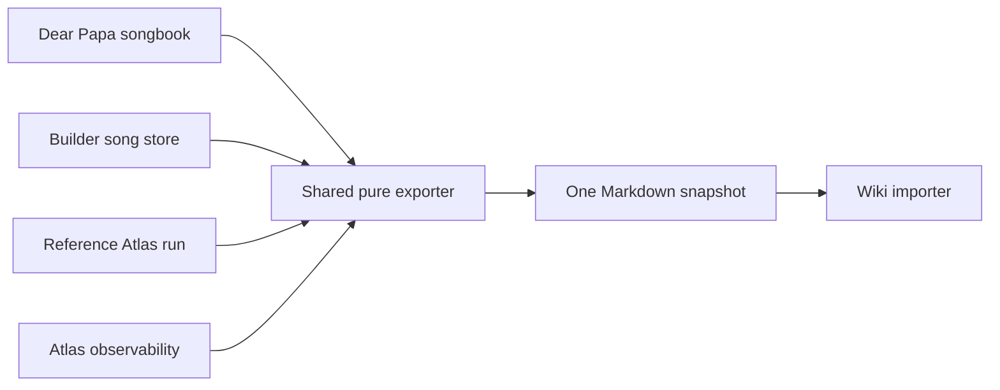

# Echo Album Master Reference File export

## Purpose

Hapa Avatar Builder can export the complete Echo Album knowledge surface as one
cross-linked Markdown file for local wiki ingestion. The file preserves the
Dear Papa source-album identity and labels Echo Album as its active projection.
It is a read-only snapshot, not a publication, approval, mint, or canon action.

Output schema:

```text
hapa.echo-album-master-reference.v1
hapa.echo-album-condensed-reference.v1
```

## Canonical inputs

The exporter reads four current sources:

| Source | Contribution |
| --- | --- |
| `data/dear-papa-songbook.json` | source track identity, titles, full lyrics, lyric provenance, sections, beat grids, vocal density, energy curves, sync state, lore, authorship, and source anchors |
| `data/hapa-songs-store.json` | Builder-normalized song metadata, lyric timings, audio and stems, story/context records, curated reference catalog, song connectors, and curated reference graph edges |
| `data/echo-reference-mining/latest.json` | current Reference Atlas cards, graph associations, run receipts, unresolved records, contribution state, authority, review, rights, privacy, and lineage |
| live Reference Atlas observability | graph/card counts, queue state, citation status, privacy telemetry, receipt links, and downstream status |

The app/API route and the default script both resolve the same live Reference
Atlas projection, including stored revisions, research overlays, media, and
preview-first authority, then calculate observability from that exact run.
Explicit `--reference-run` and `--observability` overrides remain available for
fixed fixtures and recovery snapshots.

## Repeatable flow



The compiler:

1. Resolves tracks by stable song/card ID and sorts by track number.
2. Keeps lyrics verbatim with their source status and SHA-256.
3. Merges curated song connectors, curated reference-to-reference edges, and
   live Reference Atlas edges without changing their status.
4. Groups curated and mined reference records by stable reference identity.
5. emits explicit song, reference, and association anchors.
6. Includes complete categorized metadata and telemetry as JSON blocks so
   nested fields are not lost to prose rendering.
7. Includes a source-input digest, counts, source update time, and an authority
   receipt in the export manifest.

## Use in the app

Open the Echo Album workbench and choose **Export Master Reference** in the
header. The trusted local Builder downloads:

```text
echo-album-master-reference.md
```

The UI calls:

```text
GET /api/echos/master-reference
```

The response is `text/markdown`, attachment-scoped, and marked `no-store`.

Choose **Lyrics + Main References** for
`echo-album-lyrics-and-main-references.md`. This compact profile has a hard
3,000,000-byte ceiling and keeps:

- every track title, stable ID, author/perspective summary, and available lyric;
- lyric status and SHA-256;
- every curated song-to-reference connector;
- each linked curated reference record; and
- the curated reference-to-reference graph.

It omits the mined Reference Atlas candidate graph, telemetry arrays, media,
local workstation paths, and complete metadata dumps. It fails instead of
truncating lyrics if the source corpus ever exceeds the byte budget.

## Automated use

Write the default runtime artifact:

```bash
npm run echo:master-reference
```

Choose a destination:

```bash
npm run echo:master-reference -- --out /path/to/echo-album-master-reference.md
```

Create the condensed profile:

```bash
npm run echo:master-reference -- \
  --condensed \
  --out /path/to/echo-album-lyrics-and-main-references.md
```

Pipe Markdown to another local process:

```bash
npm run echo:master-reference -- --stdout
```

Fixture/recovery runs can override each source:

```bash
node scripts/export-echo-master-reference.mjs \
  --songbook /path/to/songbook.json \
  --song-store /path/to/hapa-songs-store.json \
  --reference-run /path/to/reference-run.json \
  --observability /path/to/observability.json \
  --generated-at 2026-07-29T12:00:00.000Z \
  --out /path/to/master.md
```

Writes use a temporary sibling followed by an atomic rename. The receipt prints
the destination, byte count, SHA-256, input digest, and content counts.

## Wiki link contract

Every link has an explicit stable anchor:

| Node | Anchor | Stable URI |
| --- | --- | --- |
| Track | `#song-<stable-id>` | `hapa://echo-album/songs/<encoded-id>` |
| Reference | `#reference-<stable-id>` | `hapa://echo-album/references/<encoded-id>` |
| Association | `#association-<source>-<stable-id>-<ordinal>` | represented by its complete source record |

This lets an importer keep the file intact or split it into per-track and
per-reference wiki pages while retaining stable IDs and backlinks.

## Authority and privacy boundary

- The export reads source stores and writes only the requested Markdown file.
- It preserves `pending-review`, non-canon, evidence, rights, privacy, and
  custody labels. It does not upgrade them.
- The local snapshot can contain workstation paths and context not intended for
  public release. Review those fields before publishing outside the local wiki.
- No credentials, bearer tokens, private keys, or transient Gate material are
  input to the compiler.
- Regenerating the file replaces the chosen export artifact atomically; source
  records remain unchanged.

## Verification

```bash
node --test tests/echo-master-reference-export.test.mjs
npm run echo:master-reference -- --out /tmp/echo-album-master-reference.md
```

The focused test proves deterministic output for fixed inputs/time, complete
lyrics/metadata/telemetry/association inclusion, cross-links, atomic writing,
source-store immutability, compact-profile byte enforcement, and UI/API wiring.
