# Hell Week in Hapa Avatar Builder

Drop a text document or conversation export into **Hell Week → Create Hapa Cards** in the desktop app. LEO prepares the source, Thor designs source-linked Cards, and OpenAI illustrates each Card. Cards are saved to the Builder's Items collection with origin custody and remain pending human review.

## Operator workflow

1. Open the canonical Hapa Avatar Builder desktop app. Reopen it after installing this change so the new main/preload bridge is loaded.
2. Open **Hell Week → Create Hapa Cards**. Drop one `.txt`, `.md`, `.markdown`, or conversation `.json`, or paste text. For PDF/Word, export or paste the text first; binary document extraction is not implemented.
3. Optionally choose **Avatar foundations** (up to eight), review their images or choose **Text context only**, then **Prepare run**. Preparation indexes the complete source in resumable windows without calling OpenAI. There is no fixed document-byte or Card-count ceiling for file input. Keep the original file unchanged until discovery finishes.
4. Choose **Discover Cards · review before images** to save all designs first, or **Discover and illustrate** to continue into artwork after discovery. LEO prepares meaning and relationships; Thor produces zero, one or many distinct Cards per section, with continuation pages when needed. Processing sections are not a Card quota.
5. **Images per continuation · optional** controls artwork only. Empty means all pending images within the execution window; `5` means illustrate up to five, then pause with every remaining design saved. A later explicit continuation gets a new allowance. This is an image-count control, not a dollar budget; discovery also spends API credit.
6. Inspect saved designs, source evidence, Avatar usage and image direction. The gallery loads 24 Cards at a time. Saved designs precede registration; illustrated Cards are registered in Items with custody and remain human-review candidates.
7. **Pause after this step** commits the current request before stopping. Long work yields at its lease boundary and resumes from saved progress. Nothing resumes at app startup. Ordinary Resume reuses receipts and never replays an uncertain paid request. Explicit one-step recovery acknowledges possible duplicate billing, preserves the original attempt and pauses after recovery.

The existing encrypted Provider API key remains in Electron main. Text is sent to OpenAI only after discovery starts. File inputs are referenced in place; pasted text is retained once by content digest in private local storage (8 MiB paste-transfer bound; use the file picker for larger sources). Private agent requests/responses, section indexes and designs live on the registered external Hell Week store. Generated Card text, selected source quotes and prompts become Builder-owned records. The feature does not query account credit or impose a dollar budget.

## Review and adaptation

**Adapted** from `hapa-dev-proto` revision `3fe357e59d64a034f0e9695f428fe1aa5c5d2bf5`, specifically `electron/pipeline.ts` (`runLeoStep`, `runThorChunking`, `runThorProcessing`) and `electron/generation-templates.ts`. Builder starting revision: `d1b7171b4edec9d6011282829720f9b4fbd4ca87`.

Dev Proto's LEO prepares purpose, audience, objectives, yarn and set name from a bounded head/tail snippet. Paragraph chunking actually happens separately in the Thor stage. Thor uses chunk context and recent Cards; its media-authoring template targets Flux. The existing Builder Hell Week screen was a read-only view of Dev Proto's library.

This addition preserves that library and its responsibility handoffs in **Dev Proto library**. It adds a separate Builder-owned creation lane, reusing the saved-key provider store, existing media/Items API, Card custody and publication outbox. It does not copy or mutate Dev Proto's database, change shared Overcard contracts, resume old queues, mint Cards, or publish them externally.

```mermaid
flowchart LR
  Source[Document or conversation] --> Plan[Exact source spans and branch IDs]
  Plan --> LEO[LEO preparation windows]
  LEO --> Thor[Zero or many distinct Card designs]
  Thor --> Designs[Saved designs and repeated-source links]
  Designs --> Art[Artwork in optional batches]
  Art --> Owner[Builder media, custody and Items]
  Owner --> Review[Human review candidate]
```



## Contract and aesthetic

New runs use `hapa.builder-hell-week.v2`, implemented by `hell-week-source.cjs`, `hell-week-json-stream.cjs`, `hell-week-semantic-contract.cjs` and `hell-week-semantic.cjs`. The shared router/transport preserve the original v1 engine for existing runs; there is no migration or regeneration of accepted legacy work.

- File input is indexed incrementally in UTF-8 byte ranges of at most 12 KiB, favoring paragraph boundaries. Each range has an exact digest; a named ordered digest chain identifies the indexed source. The original real path, device/inode, size and modification time are checked on reads. Source edits hold work rather than mixing revisions. After discovery, artwork can finish using saved designs and spans without rereading the document.
- JSON is validated incrementally and retained as exact raw structure with JSON-path context, including mapping/message/parent fields when present. Unlike the legacy adapter, v2 does not flatten it into normalized speaker records or perform a complete graph-integrity audit. Long messages can span processing windows. Prompts preserve explicit branches and distinguish alternatives; this is not a guarantee of perfect cross-window interpretation. Invalid JSON and parser resource overflows are visible preparation errors. Parser bounds: depth 1,024, key length 1,024 characters, number/literal token 256 characters; these are not whole-document byte limits.
- LEO sees up to four nonempty sections and bounded continuity from earlier windows. Every requested section is required by its response schema. Thor sees its complete source section, LEO preparation, relevant prior Cards and recent page concepts. No prescribed Card count is sent. Each response contains zero to eight designs plus `has_more`; further pages continue discovery without a total ceiling.
- Each design has a stable concept key. Exact normalized concept keys reuse the earlier Card; Thor can also identify an existing semantic duplicate. Repeated occurrences retain their own source spans and quotations. The relevant-Card shortlist is bounded to 16 and semantic matching is heuristic: it cannot guarantee perfect deduplication across every document. Two continuing pages without a new concept hold for review instead of purchasing an endless loop.
- All source discovery finishes before artwork. A design-only pause and optional per-continuation image allowance retain every discovered Card. Actual storage availability, finite memory, provider limits and execution leases remain practical constraints; there is no promise of physically unlimited input or output.
- Legacy v1 runs retain their original 600,000-byte / 10,000-node / 1–96-Card preparation contract and one-Card-per-chunk behavior. New runs no longer inherit those ceilings. CLI `--max-cards` is explicitly retired.
- Agent output uses OpenAI Responses structured JSON with `store:false`. Prompts explicitly treat source instructions as untrusted material and separate factual claims, desires, uncertainties and invented lore.
- Thor supplies title, kind, summary, facts/desires/uncertainties, lore, skills, exact supporting quotes, visual thesis, image prompt and tags. At least one quote must match the supplied source. One outer quote pair can be normalized; invented or shortened quotations remain flagged and do not count as evidence. Validation does not independently prove generated factual claims; human review remains necessary.
- Artwork retains the successful Echo tests' painterly graphic-novel/anime direction: elegant contours, rich natural light, lived environments, celestial geometry and antique gold, with a coherent scene/action. No baked-in words, logos, borders or multi-panel collages. The Card UI supplies typography separately. Avatar foundations are optional and explicitly selected; no active Avatar is attached automatically.
- Defaults preserve the Dev Proto text-model pairing: LEO `gpt-4o`, Thor `gpt-4o-mini`; image model `gpt-image-2.5-sunburst-2026-09-08`, high quality, 1024×1536 PNG. Models and quality are editable before preparation. No provider/model fallback occurs silently. Availability depends on the saved key's project.

## Durable execution and custody

`electron/hell-week-generation.cjs` is the shared UI/CLI execution spine. Small run pointers/configuration/Avatar snapshots live under Electron user data's `Hell Week Runs/<run-id>/`. V2 indexes, receipts, accepted discovery pages, per-Card designs, concept catalog and repeated-source occurrences live under `runs-v2/<run-id>/` on the registered external store. Original file bytes are reused in place. Configuration and source identity are frozen at preparation. Atomic, fsynced receipts/pages/cursors and event records protect reusable work. This is recovery on the named devices, not independent-device backup protection.

Accepted discovery pages are saved before individual Card files and cursors, with stable Card identities. Restart replays that acceptance idempotently without purchasing another response. Image receipts likewise survive the image-to-registration gap. Card lineage records the source digest algorithm, exact UTF-8 spans, concept key, origin call ID, repeated-source count/index reference, selected and used Avatar snapshots, models and artwork digest before custody. The occurrence URI is a provenance identifier for the private index, not a public HTTP download.

V2 local controls are bounded to 128 KiB per run under the shared 128 MiB lane ceiling (9 MiB preparation admission allowance including a possible paste). External metadata and artwork share the existing 2 GiB store ceiling and 20 MiB default admission margin (16 MiB object plus 4 MiB metadata/commit room); small preparation batches recheck admission every 64 ranges, paid steps check before dispatch. Accounting takes the larger of logical size and allocated blocks for each file, includes directory allocation and filesystem sidecars, and checks local controls on every save. Existing 32 MiB owner previews, 24 MiB private-gallery derivatives and 384 MiB backups remain separate bounded classes. Peak additional request memory is forecast at 384 MiB above the app baseline, not an OS RSS enforcement claim. No DB/WAL/SHM or input-media mirror is introduced. No quota is raised automatically and accepted results are not evicted. Missing/full storage holds work; local run counts remain visible and a full but readable store still permits browsing saved designs. File-operation timeouts do not claim cancellation of every kernel-level filesystem stall.

Only one worker may own the job store. A second UI/CLI sees that live ownership and cannot overwrite progress or dispatch duplicate requests. Proven-dead locks can be reclaimed once; uncertain ownership fails closed. No child agents or generation workers are spawned by the pipeline itself. External storage checks invoke the bounded system disk-identity utility.

Paid dispatch records a request commitment first. Responses are saved before the next cursor: if interrupted between those commits, resume consumes the saved receipt without replay. A transport failure, HTTP 5xx, or otherwise ambiguous paid result stops for review. The UI explains possible duplicate billing and offers one explicitly confirmed recovery request; it archives the original attempt and pauses after saving that step. Ordinary Resume never authorizes this replay. A known HTTP 4xx rejection permits one explicitly requested retry, with a maximum of two total attempts for that request. Validation failures retain original provider responses and do not automatically buy replacements.

A worker has a 30-minute lease and admits a step only with room for its timeout and a 30-second commit reserve. Text/image timeouts are 180/240 seconds. Long runs yield between steps and need explicit resume. At most one paid request can have an uncertain outcome after interruption. Calls already committed remain protected.

Registration checks the exact local Builder owner before generation and before writes. Native execution establishes an HttpOnly same-origin local session; CLI uses the existing admin-token environment variable. Before first registration, the existing Items/media stores are backed up under ignored `data/backups/hell-week/`. Stable run/Card/artwork IDs and hash checks reconcile incomplete registration. Media and Cards are written through owner APIs, never by directly editing live stores. Each new Card receives origin Hypercore custody before Items/outbox registration. Origin custody, fleet acknowledgement, mint and canon remain separate states.

## Interfaces

| Surface | Behavior |
| --- | --- |
| Desktop UI | Hell Week → Create Hapa Cards: prepare, start, pause, status, saved artwork and evidence. |
| Trusted IPC | `hapa-hell-week:create/prepareMore/start/pause/status/asset/reconcile/avatars/avatarOptions`, exposed as `window.hapaHellWeek`; sender restricted to the trusted Builder window. Keys never cross the preload boundary. |
| CLI | Repository Electron executable with `cli/hell-week.cjs`: `create FILE`, `prepare ID`, `run ID [--design-only] [--images=COUNT]`, `resume ID`, `pause ID`, `status [ID]`. `--help` describes registration options. Create is the no-spend preparation step. |
| Owner HTTP | Existing `/api/local-ui-session`, `/api/health`, `/api/media`, `/api/cards/custody/ensure`, `/api/items`, `/api/items/cards`. No new remotely callable paid generation endpoint. |
| Ordinary browser | Can inspect Dev Proto library; creation explicitly requires the desktop saved-key bridge. This is a stated parity boundary, not a silently broken browser action. |

Example from the repository root:

```sh
./node_modules/.bin/electron cli/hell-week.cjs create notes.md
./node_modules/.bin/electron cli/hell-week.cjs status RUN_ID
./node_modules/.bin/electron cli/hell-week.cjs run RUN_ID --design-only --api-base=http://127.0.0.1:8797
./node_modules/.bin/electron cli/hell-week.cjs resume RUN_ID --images=5 --api-base=http://127.0.0.1:8797
```

The run/resume commands spend API credit and needs the owner's existing `HAPA_AVATAR_ADMIN_TOKEN` environment configuration. Never put a token in a command argument or source file.

## Historical v1 acceptance and operational lesson

On 2026-10-29, one synthetic seed-archive source produced **The Keeper's Chronicle** through the real saved-key/OpenAI/Builder custody route: one LEO call, one Thor call and one image call. The generated portrait was inspected: a coherent painterly greenhouse scene with two gardeners, glowing plants and a celestial landscape. The run completed with three paid calls; no paid retry was used. This is a one-Card acceptance, not a claim that every long document/model combination has been qualified.

The first Thor response wrapped literal quotes in another quotation pair and shortened a third with an ellipsis. Strict matching correctly stopped before image spend. The correction accepts a single outer wrapper while keeping the shortened quote flagged. Resume consumed the original saved response. A subsequent local owner-health timeout also stopped before further spend; after an independent healthy probe, resume completed. Original receipts remain intact.

**Lesson/Flow candidate:** preserve provider responses before interpreting them. Validation can improve without purchasing another response or rewriting the original evidence. Likewise, worker ownership must be acquired before changing a retry cursor, not after accepting the start request.

Source: Calder's 2026-10-29 Codex request to bring Dev Proto Hell Week into Builder; implementation and verification by Codex in that task. Private canary/source receipts are intentionally excluded from Git. See [the design and verification record](HELL_WEEK_DESIGN_REVIEW.md) for the bounded acceptance state.


### Connection recovery correction — 2026-10-29

A larger operator test completed its first LEO window, then failed on the second request before an HTTP response was recorded. The old message retained only `fetch failed`, so its precise network cause could not be reconstructed. Ten later unauthenticated checks in the desktop runtime reached OpenAI successfully; this establishes current reachability, not historical billing or a permanent network fix.

The engine now records a bounded network code, elapsed time and whether an HTTP response arrived. The UI distinguishes an uncertain paid request from a normal resumable pause. An explicitly acknowledged retry archives the original request/receipt, permits one additional attempt (two total maximum), preserves completed windows, and pauses after the recovered step. This acknowledgement and recovery boundary survive interruption. CLI equivalent: `resume ID --retry-unknown=leo-1 --acknowledge-possible-duplicate-charge`. There is no automatic replay or automatic continuation of the remaining batch.


### LEO coverage correction — 2026-10-29

An operator's third LEO window returned a complete HTTP response but prepared only one of four requested chunks. The original array schema allowed this even though the prompt requested complete coverage. Validation correctly stopped, but ordinary Resume could only reread the same incomplete response.

New LEO requests use an object whose required keys are the exact requested chunk IDs. The normalized internal Card context remains an array, and complete legacy responses still work. Duplicate or foreign IDs remain errors. A known incomplete response can be repaired with **Complete missing preparation**: one distinct request includes only omitted source chunks, preserves already-prepared entries and the original response, records its lineage, and pauses. CLI: `resume ID --repair-leo-window=2` (zero-based window index). A repair response is durable and reused on interruption; no repeated whole-window regeneration occurs. Previously dispatched requests retain their original saved payload and digest even after the schema upgrade.


### External artwork and bounded working set — October 29

New native/CLI generation uses a registered external object store configured by `hell-week-storage.json` in the existing Electron user-data directory. This private file names `mount` and `volumeUUID`; workstation identifiers do not belong in Git. The default store is `Hapa-Avatar-Builder/HellWeek` on that volume. On this Mac Studio the configured external store was verified before the large run. Another machine must explicitly configure its own registered store; there is no local full-media fallback.

New PNG bytes are hashed and written once into `objects/<sha256>.png`. Run receipts and Items media assets carry the external object reference, digest, size and volume identity. The trusted resolver verifies the volume and exact bytes. Items references the external original through its existing local-file resolver; full-size media upload is skipped, avoiding a second internal copy. Small owner previews use the media endpoint as described below. Distinct Cards retain separate provenance even if their exact encoded artwork bytes match. Existing legacy PNGs are readable and remain untouched; no migration, deletion or reclaimed-space claim is made.

The shared engine worker lock allows one in-flight request across UI/CLI runs. External reservations are persisted by call ID; object publication uses a synced temporary object and digest verification before rename. An interrupted temporary object is verified and reused, or held for review if corrupt. Defaults: 2 GiB external store including temporary/control files, 16 MiB per PNG, 100 GiB free external safety reserve. Missing/wrong/read-only/full drives hold generation. A drive failure after provider dispatch may leave an uncertain paid outcome; no fallback copy or automatic paid replay occurs.

Local limits for this lane: 128 MiB private run records including journals/abandoned attempts with a 4 MiB admission allowance; 1 MiB text response and 24 MiB image response limits; 384 MiB Hell Week backup ceiling including write allowance. The large-run estimate is at most 1.36 GiB artwork for 85 maximum-size PNGs, plus bounded external controls, no independent replica. Expected local growth is under 128 MiB controls, one approximately 107 MiB owner-store backup, and 32 MiB Card/custody metadata, with under 256 MiB owner JSON rewrite workspace. Existing owner API stores/outbox keep their own lifecycle; this feature does not retrofit quotas across unrelated writers. No DB/WAL/SHM is introduced by Hell Week. Local/native previews are 512px, at most 256 KiB JPEG each, generated in memory only when near the visible gallery and released when off-screen. The native IPC preview is transient. The subsequent owner-preview correction below adds a separately bounded persistent derivative namespace for Items.

External corruption, wrong/missing drive, shared-store cap, repeated resume, and reference-only registration have focused regression coverage. A real image was written and registered through this path. This qualifies this lane's tested paths, not all Hapa runtimes or independent disaster recovery.

### Exact source excerpt selection

New Thor requests select IDs from a deterministic list of literal excerpts in the current chunk. Builder resolves those IDs to source text and validates them. This prevents the model from presenting paraphrases as literal quotations; it does not independently verify every factual claim in a generated Card.

A legacy design with invalid quotes remains saved. **Repair source quotes · continue run** (CLI `--repair-thor-evidence`) purchases one focused evidence-selection response, retains the original design/response and unverified quotations, records the repair lineage, and continues. Saved repair responses are reused after interruption. Early enum-of-quote-string repair requests hit an API restriction on quotation marks inside enum literals; the corrected ID-based repair has a distinct versioned call ID, preserving the rejected receipts. No accepted request is silently changed.


### Owner attachment verification

Items normalizes media references and does not recognize an API URL whose pathname lacks a media extension. Initial external attachments used `/api/local-file?path=…` and were silently dropped by that normalizer even though artwork generation and custody succeeded. The corrected adapter stores a standard `file:` URI ending in `.png`, which the existing UI resolver serves through the local-file API. The external descriptor is retained in media metadata, which survives owner normalization.

Registration now verifies the attachment survived the real owner response before marking a Card saved. **Verify saved Card links · no generation** / CLI `reconcile ID` holds the shared worker lock, verifies saved artwork and repairs missing attachments through Items while preserving current Card text and custody. It makes no OpenAI request and creates no new image copy. Interrupted reconciliation can be repeated safely. Registration tests now exercise the actual Item normalizer, not just a pass-through mock.


### Bounded Items previews

The live headless owner API could read internal files but stalled when reading this registered external volume; the desktop process could read the same originals successfully. No permission setting or full-size storage placement was changed. Items now receives a JPEG preview through its existing media API: at most512px high /256KiB, keyed by the full-size source digest and preview recipe. Existing matching preview records are reused and bytes verified. All `hw-preview-*` files count toward a shared32MiB cap with a512KiB admission margin. The private review-gallery derivatives have a separate24MiB cap; combined durable preview allowance is56MiB. These are explicit display derivatives, not retained full-size evidence copies.

Items retains the external original URI/digest plus the local thumbnail URI and source/preview hashes. Reconciliation adds missing previews without regenerating art or replacing Card text/custody. Full-resolution HTTP delivery from this headless API to the external drive remains unqualified; native Hell Week reads verify the external original directly. The operator can open the external original files independently. No OS access permissions were expanded.


### External-read hold observed during the large run

The authorized 85-Card operator run completed all 22 LEO windows, preserving exact preparation coverage of all 85 chunks. It saved 38 Cards to Items with verified custody, source quotes, external references and bounded local previews; a 39th image response/object receipt was committed before registration stalled. This is partial acceptance, not a completed 85-Card run.

The drive retained its expected UUID/mount, writable status and reported ample free space, but separate bounded reads of the latest image, an earlier image and the tiny store marker all timed out. A one-second worker sample showed a filesystem `open` waiting in the OS; drive-related kernel logs did not establish a cause. The task worker was stopped after preserving the response and requesting pause; the Builder UI/API were retained. No drive unmount, repair, permission change or local full-media fallback was attempted.

External file-content reads now time out after 15 seconds with a visible held error. A pending timed-out read is retained in the storage instance and subsequent reads are refused until it settles, preventing serial retries from accumulating blocked reads. This does not claim to cancel a kernel-level file open or bound every filesystem mutation; a process with a blocked OS read may still need bounded external termination. The recovery test proved the live preflight held with the request count unchanged, so no paid image replay occurred. Normal resume can reuse the 39th saved response after drive access is restored.29 focused recovery/registration/storage tests pass.

The review gallery can reuse the owner's already-verified small previews without touching external originals or copying those previews again. All 38 registered Cards were rechecked locally for exact source quotes, custody, original references and preview hashes (1,979,442 preview bytes). Current external-original readback remains blocked; the write-time hashes are retained, not represented as a fresh readback. The complete-run acceptance is pending external access recovery.


### Completed large-run acceptance — October 29, 2026

The operator's authorized run finished at 2026-10-30T01:20:11Z (October 29 local time): **85/85 Cards**, all 22 LEO windows, all 85 source chunks prepared exactly once. Final acceptance freshly read and hashed every external original, checked 1024×1536 dimensions, verified every owner attachment/custody record and exact source quote, and verified all local preview digests/source links. There are 85 distinct external PNG objects totaling249,161,467 bytes and 4,362,914 bytes of owner JPEG previews. No internal full-size copy was created for this run. The review gallery reuses existing owner previews; its previously retained 770,162 bytes of preview derivatives remain intact.

The earlier external-read hold recovered without a disk repair or permission change; the saved 39th image was verified and reused. Subsequent local health-check timeouts interrupted Card 61/62 registration. Route-specific diagnostics isolated a read-only owner health probe; independent Node/Electron/curl checks later passed. The registrar now consumes health response bodies and allows one bounded retry of that read-only probe, refusing persistent failure after two reads. Owner mismatch still fails immediately; mutations and paid requests do not inherit automatic retry. The precise transient OS/network cause remains unknown. Registration resumed from saved images, and the run completed without image regeneration.

Final recorded usage estimate: **$4.1668732** (LEO $0.4962, Thor $0.1019082, images $3.568765), based on saved usage and official model prices checkedOctober 29. This is not account billing/credit balance and excludes the archived earlier unknown-outcome LEO attempt.197 dispatches include 194 successful responses, two rejected evidence-schema attempts and one earlier uncertain attempt; 192 was the original plan. All original attempts/repair lineage remain retained.

The final 31 focused recovery/registration/storage tests pass. The production build and 54 Overcard tests passed earlier in this same task; subsequent changes are in the main-process storage/registration modules and their focused tests. The native shell was reopened with the final code and confirmed **Ready for review  / 85 of 85 saved**. The existing API service was retained. Artwork samples from early, middle and later sections were visually inspected; this does not imply human review of every Card.

The earlier recorded 11 full-suite failures and Tarot smoke failure remain outside the Hell Week path; source changes remain uncommitted under the owner's completion rule. Completing this operator run does not clear that broader release gate. Full-resolution delivery through the headless local-file HTTP route also remains unqualified; verified external originals and native/owner previews are usable. No external publication, mint, canon adoption or broad runtime/storage-compliance claim is made.


Final delivery follow-up: after external access recovered, a bounded live GET through the existing headless `/api/local-file` route returned HTTP 200 and the final original's 3,131,806 bytes in 0.03 seconds with the exact saved SHA-256. This supersedes the earlier currently-unqualified delivery checkpoint for that tested route/file. All 85 originals had already passed direct full-byte verification. The earlier transient failure's underlying cause remains unresolved; no restart of the API, disk repair or permission change was required.


## Optional Avatar foundations — October 30, 2026

Calder requested the existing document workflow with one or several Builder Avatars as creative foundations, while retaining adventurous Hapa artwork and attributable origins. The picker extends the same creation lane; it does not rewrite the completed Italian run or assign the currently active Avatar implicitly.

**Prepare** resolves selected Avatar IDs through the canonical Builder's paginated index and existing Avatar attach-pack endpoint. The trusted main process takes a bounded profile snapshot plus one selected local PNG/JPEG/WebP per Avatar, or an explicit text-only choice. The UI previews the chosen image and lets the operator replace/remove it before preparation. Missing or invalid choices produce a recoverable error; nothing is paid at this stage. Draft selections apply only to new runs; saved runs show their frozen foundations.

LEO receives names, aliases and bounded profile/persona context. Thor receives the same context and returns `avatar_uses` with a selected ID, role and reason for every Avatar actually used on a Card. Unknown or duplicate IDs are rejected. Profiles are untrusted creative context, never proof of document facts, speaker identity or operational authority. Thor may choose an empty list for an abstract/environmental Card. Visual direction preserves character identity while encouraging varied composition, meaningful actions, impossible geography and painterly Hapa scenes.

For each Card, only its used visual references are sent as ordered `image[]` parts to OpenAI `/v1/images/edits`; names and image positions are explicit in the prompt. Cards using only text profiles or no Avatars retain `/v1/images/generations`. LEO and Thor receive profile text, not image pixels. The immutable request manifest stores reference descriptors, never base64 image copies. Reference bytes are checked against the prepared path, size and SHA-256 before any image dispatch commitment. A changed or unavailable image blocks that step and requires restoring the exact source or preparing a new run; it never silently substitutes an updated Avatar. An already-saved image response remains reusable even when its reference becomes unavailable.

### Lineage and storage

Run `source.json` and `run.json` retain `avatars`: stable Avatar IDs/names, source URI/update time, exact retrieved attach-pack digest, profile snapshot digest, bounded context, reference asset/slot/role/URI/size/MIME/hash, and owner/relationship attribution. The attach-pack digest identifies that retrieved packet; it is not a claim to be the raw Avatar record's custody digest. Existing rights/ownership are not transferred by selection.

Every new Card includes `avatarLineage` (schema `hapa.hell-week-avatar-lineage.v1`) in `cardRecord.hellWeek` and artwork metadata. It separates all run foundations from the used subset, including each used role/reason, profile-only versus profile-and-image mode, snapshot hashes and image descriptors. The local filesystem path is omitted from this Card projection. `connections.avatarIds` lists the used subset. These fields exist before origin custody creation, alongside source digest/spans, supporting quotations, models, run/chunk identity and image prompt. Reconciliation refuses a conflicting Avatar lineage instead of falsely accepting an existing Card. Legacy runs keep working without Avatar fields.

No reference originals are copied into run folders. Existing owner media remains in place; generated full-size artwork stays on the registered external store. Limits: eight Avatars, 8 MiB/image, 32 MiB total reference bytes, 64 KiB profile/image descriptors per run, conservatively 384 MiB additional peak request memory (including multipart and bounded response parsing copies, above the existing app baseline; this is a forecast, not an OS RSS enforcement limit). A 15-second guard covers reference file access and holds a stalled operation rather than accumulating retries. Existing shared control-record (128 MiB), backup (384 MiB), preview (32 MiB), external object/store caps and lease/replay rules still apply. Reference image inference may add time and API cost; the UI's historical timing is not a guarantee.

### Interface parity

- Native UI: **Avatar foundations**, searchable multi-select, per-Avatar reference image/text-only option, saved run foundations, and per-Card used references in source evidence.
- Trusted IPC: `avatars()` returns the bounded roster; `avatarOptions({avatarId})` returns existing reference choices; `create({...source, avatarSelections:[{avatarId, assetId?}]})` freezes selections. Omitted `assetId` chooses the displayed default; `null` explicitly means text-only. Renderer-supplied profile/path fields are not trusted.
- CLI: `electron cli/hell-week.cjs avatars`; `avatar-options ID`; `create notes.md --avatars=red-reaper,avatar-2`. For exact image choices use `--avatar-selections=choices.json`, containing the same selection array (for example `[{"avatarId":"red-reaper"},{"avatarId":"avatar-2","assetId":null}]`). These commands make no OpenAI calls. Existing run/resume authorization remains unchanged.
- Owner HTTP reuse: `GET /api/avatars?mode=index&limit=250&offset=...` and `GET /api/avatars/:id/attach?target=hell-week`; no new paid HTTP endpoint or raw full-store mirror.

### Acceptance and learning delta

38 focused Hell Week checks passed: zero-reference compatibility, exact file snapshots, unknown/duplicate rejection, multi-Avatar profile propagation, ordered used-only multipart pixels, text-only/abstract generation, changed-file stop before dispatch, image-receipt crash recovery without reference rereads or payment, and Avatar lineage retained through the real Item normalizer before custody. Production build and 54 shared Overcard checks passed. Native UI acceptance selected Red and Blue from the live 77-Avatar roster, displayed reference previews, changed Blue to text-only, and saved a one-Card prepared sample with two frozen foundations and zero API calls. This validates wiring and recovery; no new paid image or artistic-quality acceptance was performed for this feature.

The first native shell launch crashed before Hell Week interaction; direct reopening to the existing Hell Week route worked. The specific OS/Electron cause was not established. Broad repository acceptance is tracked separately; do not interpret focused feature checks as a full release pass.

**Lesson/Flow candidate:** distinguish references offered to an agent from references actually used in an artifact. Persist both, preserve identity by stable ID and snapshot/pixel digest, and pass only the used images into generation. This keeps creative freedom while making later review and reuse truthful. Source: Calder's October 30 Codex request and this implementation/acceptance turn; no alternate agent identity adopted.

Final broad acceptance for this batch: `npm test` finished in 820.5 seconds with 3,297 tests: 3,285 passed, 11 failed, one skipped. Failures concern Echo/Director album structure/cuts, hydration/UI assertions, native shader routing, media/default contracts, static-API routing, reference-media loop binding, typed playback manifests, readiness UI, compact summary and semantic ranking. The separate Tarot smoke loaded the current UI but failed Echo preview readiness. These are outside Hell Week; a clean pre-change baseline was not established during this feature batch. Required broader gates are not green, so no completion commit was created. Source remains local and uncommitted; no push/publication occurred. Live CLI Avatar discovery also returned the same 77 entries.


## Semantic discovery and hardening — October 30, 2026

Calder clarified that long documents should yield as many worthwhile Cards as their content warrants, then authorized implementation and hardening. The earlier maximum-Card design conflated processing windows, creative output and image spending. V2 separates those concerns while reusing the existing transport, storage identity, Avatar foundations, custody registrar and native surface. Existing v1 runs stay on their original engine.

Focused verification now includes files larger than the old byte limit with over 96 processing sections, exact UTF-8 reconstruction, JSON boundaries, repeated import resumes, zero/multiple Card sections, page continuation, deduplication with occurrence retention, image-batch pauses, source changes, design-only review, two accepted-page interruptions, two saved-image interruptions, explicit uncertain recovery, non-advancing discovery, lease exhaustion, missing drive and full-store browsing/admission. All provider calls in these tests are fixtures; this update has not purchased a live generation.

**Lesson/Flow candidate:** input coverage, worthwhile concepts and illustration spend need separate durable cursors. A chunk count is neither a creative target nor an honest spending budget. Persist accepted designs before artwork, keep repeated source evidence without requiring duplicate art, and make pause limits explicitly resumable. Semantic coverage/deduplication remains model-dependent and deserves human review. Source: Calder's October 30 request in this Codex task; implemented by Codex /root without adopting another identity.


Semantic v2 acceptance: the final focused Hell Week suite passed 55 checks, including 105 discovered designs from a single processing section without images, Avatar profile/pixel/lineage propagation in v2, local control-budget holds and allocated-block accounting. The build and 54 Overcard checks passed. Native preparation accepted a 1,309,344-byte Markdown file as 108 sections, with Red's image/profile foundation, zero paid requests and an unknown final Card count. CLI readback agreed; the completed legacy run still reports 85/85 Cards and 197 historical attempts. The shell was reloaded for the new main/preload paths. This is no-spend functional acceptance, not a new live model/art-quality qualification.

The native sample's private run/plan measured 3,732/3,057 bytes. Its external index/events measured 474,102 logical file bytes and 28,835,840 allocated file bytes before directory accounting, including 111 filesystem sidecars on this drive. That allocation amplification is now counted against the same store ceiling; no original document copy or new full-size image was created. Tiny-file consolidation is a future efficiency improvement, not a reason to undercount this footprint. No bytes were reclaimed and no independent backup was created.


Final broader verification for semantic v2: `npm test` finished naturally in 790.8 seconds: 3,308 tests, 3,296 passed, 11 failed, one skipped. The same previously observed Echo/Director areas remain red (project structure/cuts, editing hydration, shader handoff, frame/media defaults, static-API routing, reference-loop binding, typed playback, recording readiness, compact summary and semantic ranking). A clean baseline was not established. The final late prompt/control-budget/allocated-block changes were covered by the subsequent 55-test focused pass; the full suite was not repeatedly restarted. Tarot smoke loaded the target with no collected renderer errors but failed Echo preview readiness with no project. Owner-required broader verification is therefore not green: source remains uncommitted, and no push/publication occurred.

The final registered-store preflight passed with 296,484,864 accounted bytes under the existing 2,147,483,648-byte ceiling; the no-spend sample accounted for 29,229,056 bytes including directory/sidecar allocation. The earlier restricted shell could not access Disk Management; the approved read-only check verified the drive without changing mounts, permissions or storage placement. These are measured local results, not a fleet compliance or independent-backup claim.


## Commit policy correction — October 30, 2026

After the implementation handoff, Calder explicitly requested committing this work and changing the repository rules to fix failing tests or commit new work with failures recorded. AGENTS.md now permits scoped development commits despite remaining failures, requires honest verification/causality/follow-up notes, and preserves separate publication/release gates. This supersedes the earlier completion-commit blocker statements above without rewriting their historical evidence.

This Hell Week checkpoint includes the native LEO/Thor pipeline, Avatar foundations, semantic discovery, external storage and recovery hardening, tests and owner documentation. The current evidence remains: 55 focused Hell Week checks and 54 Overcard checks passed; production build and no-spend native/CLI acceptance passed; full suite 3,296 passed / 11 failed / one skipped; Tarot smoke fails Echo preview readiness. The 11 failures are the previously observed Echo/Director checks listed above; no clean-baseline causality proof is claimed. Follow-up: repair those Echo/Director assertions/runtime contracts and Echo preview readiness in their owning scope, then rerun affected broad gates before claiming a clean release. No tests were weakened, unrelated dirty changes were included, or paid calls made for this commit.


## Reviewed Dreamer design intake — November 4, 2026

[Reviewed-design import](REVIEWED_DESIGN_IMPORT.md) sends exact authored Cards
into this existing artwork engine without rediscovery. The separate no-spend
CLI prepares designs and reads receipts; native artwork controls remain explicit.
